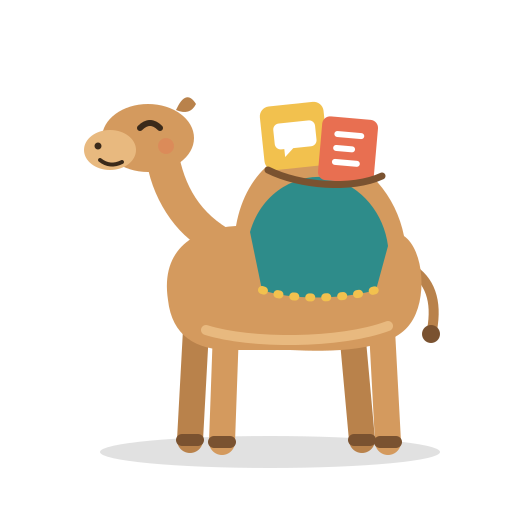

<p align="center">
  
</p>

<h1 align="center">Karvan</h1>

<p align="center">
  <b>Sync Claude Code between your computers.</b><br>
  Start a conversation at work, continue it at home with <code>claude --resume</code>, exactly where you left it.
</p>

<p align="center">
  <a href="https://github.com/leberman/Karvan/actions/workflows/ci.yml"></a>
  <a href="https://github.com/leberman/Karvan/releases/latest"></a>
  
  
</p>

---

If you use **Claude Code** on more than one computer (a work machine and a laptop, a desktop and a
server), everything that makes a conversation useful stays on the machine where it happened: the chat
history, your `CLAUDE.md`, your skills, each project's memory, and the half-finished code you were
working on. **Karvan** (Persian for *caravan*) carries all of it between your computers, automatically.

## Features

- **Resume any conversation on any computer.** Conversations sync so `claude --resume` on one
  machine lists the sessions from the others. If you continue the same conversation on two machines,
  both sides are kept: Karvan merges them line by line and never drops a message.
- **Claude desktop app support.** The Code tab's session list follows you too.
- **Your setup everywhere.** `CLAUDE.md`, skills and per-project memory stay the same on every
  machine, with three-way merging when two machines edit the same file. Per-machine instructions go in
  `CLAUDE.machine.md`, which never leaves the machine.
- **Unfinished git work (optional).** Branch, unpushed commits, staged and unstaged changes and new
  files are saved; `karvan restore` brings them to the other machine. Karvan never commits, pushes,
  stashes or resets in your project.
- **Projects at different paths.** `~/work/app` here, `~/code/app` there: projects are recognised by
  their git remote, and Karvan finds them for you.
- **Automatic.** Claude Code hooks sync when a session starts and ends, a timer syncs every 10 minutes,
  and once more at logout and shutdown.
- **Your storage.** A private Git repository (GitHub, GitLab, any SSH remote; git is built in, nothing
  to install) or any folder that Dropbox, Google Drive, OneDrive or Syncthing keeps in sync.
- **Works on difficult networks.** SSH over port 443, retries, resumable downloads, several mirrors.

## Quick start

On your first computer:

```sh
curl -fsSL https://raw.githubusercontent.com/leberman/Karvan/main/install.sh | sh
karvan init
```

`karvan init` asks a few questions: a name for this machine, where to keep your data (create an empty
**private** repository such as `karvan-data` first), and which projects to sync (it finds the folders you
used Claude Code in). It sets up SSH access for you if needed, installs the hooks and the timer, and syncs.

On every other computer, run the same two commands, give the machine a different name and use the
**same** repository. That's it.

The installer downloads a prebuilt binary and checks its SHA-256; if that is not possible it builds from
source, installing Go for Karvan only (no sudo). Update any time with `karvan update`.

## How it works

```
  work computer               your private repository              home computer
  ~/.claude  ──karvan sync──►  manifests/work.krv   ◄──karvan sync──  ~/.claude
                               manifests/home.krv
                               blobs/… (compressed file contents)
```

Each computer publishes a small manifest of what it has, plus the contents of new files. Every computer
reads the others' manifests and brings its own files up to date. Karvan has its own sync engine: the
repository is only storage, Git merges are never used, and nothing is ever force-pushed. Conflicts are
resolved without losing data (conversations are merged line by line; text files are merged three-way,
and if that is impossible both versions are kept side by side).

The design is in [docs/sync-engine.md](docs/sync-engine.md).

## What is synced

| What | Where | Default |
| ---- | ----- | ------- |
| Conversations (last 7 days, configurable) | `~/.claude/projects/<project>/*.jsonl` | on |
| Desktop app session list | `~/.config/Claude/claude-code-sessions/` | on |
| Global instructions | `~/.claude/CLAUDE.md` | on |
| Skills | `~/.claude/skills/` (except `synced/`) | on |
| Project memory | `~/.claude/projects/<project>/memory/` | on |
| Unfinished git work | your project's repository | off |
| Personal folders | any folder you add | off |
| `settings.json`, credentials, `.env`, `CLAUDE.machine.md` | | **never** |

## Commands

| Command | |
| ------- | - |
| `karvan init` | set up this computer, or change settings and add projects |
| `karvan status` | last sync, your other computers, conflicts, anything waiting |
| `karvan sync` | sync now |
| `karvan restore` | bring unfinished git work from another computer |
| `karvan doctor` | check the setup: hooks, timer, store access, network |
| `karvan update` | update to the latest release |
| `karvan uninstall` | remove hooks and timer (your data stays) |

## Privacy and security

- Karvan only talks to the storage **you** choose. There is no Karvan server.
- `karvan init` refuses public GitHub repositories.
- Credentials, `.env` files, `settings.json` and Claude's login state are never read or sent.
- **Encryption is not in this version yet** (planned for the next milestone): until then, use a private
  repository or a private folder only.

## FAQ

**Does it work with the Claude desktop app?** Yes: conversations from the Code tab and its session list
sync. The app reads its list when it starts, so after new sessions arrive, quit it (Ctrl+Q) and reopen.

**My network blocks SSH (port 22).** Use GitHub's SSH on port 443:
`ssh://git@ssh.github.com:443/<you>/karvan-data.git`. `karvan init` does this for GitHub addresses.

**What if I continue the same conversation on both machines?** Both continuations are kept in the
conversation file; nothing is lost.

**Windows / macOS?** Linux first; Windows and macOS are planned.

## Roadmap

- **M0** – feature parity with the original prototype (done)
- **M1** – encryption (age), secret scanning before upload, multiple projects polish
- **M2** – public Linux release: packages, docs
- **M3** – cloud-folder storage for everyone, tray icon
- **M4/M5** – Windows, macOS

## Documentation

- User guide (Persian): [docs/guide.md](docs/guide.md)
- Sync engine specification (Persian): [docs/sync-engine.md](docs/sync-engine.md)
- Product requirements (Persian): [docs/PRD.md](docs/PRD.md)

## License

Licensed under either of

- Apache License, Version 2.0 ([LICENSE-APACHE](LICENSE-APACHE))
- MIT license ([LICENSE-MIT](LICENSE-MIT))

at your option.
